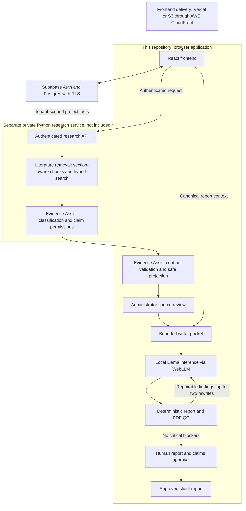

# Sensory Platform

[](https://github.com/FermIQDataTeam/Sensory-Platform/actions/workflows/ci.yml)

Sensory Platform connects food-product evidence, research operations, decisions,
concept validation, and commercialization reporting in one project workspace.

**Data → Studies → Responses → Insights → Decision → Concept → Report**

[Open the live demo](https://sensory-platform.vercel.app) ·
[Use the demo accounts](DEMO_INSTRUCTIONS.md)

## My contributions

I'm Josiah deGrasse. I led the design and implementation of the following work,
using Claude Code and Codex for coding assistance, debugging, and verification:

- Built AI-assisted research and commercialization-report workflows that connect
  project evidence, decisions, concept results, and report versions.
- Developed section-aware chunking and hybrid retrieval in the **separate Python
  RAG service**, and integrated that service into this platform.
- Designed Evidence Assist contracts and report-safe projections to restrict
  external literature to permitted uses and keep raw retrieval data out of the
  writer packet.
- Implemented deterministic report validation, evidence checks, and QC gates
  around generated output.
- Integrated on-device Llama report generation through WebLLM, including
  recovery from incomplete structured output.
- Built source review, report approval, and claims-review steps for human
  oversight before client release.

These are my engineering contributions; the language models and underlying
frameworks are third-party components. See the [AI evaluation record](docs/ai-evaluation.md)
for reproducible checks, a documented failure fix, and the limits of the evidence.

<p align="center">
  
</p>

<p align="center"><sub>Live panel evidence, prototype comparison, and decision readiness in one project workspace.</sub></p>

## The product

Food-product evidence is often split across instrument exports, survey tools,
spreadsheets, and presentation decks. Sensory Platform keeps that evidence tied
to a stable project and answers three practical questions:

- What evidence belongs to this formulation?
- Is it ready to move forward?
- What should the team do next?

Each project retains its imports, studies, panel responses, analysis, confirmed
decisions, concepts, and report versions. Recommendations remain traceable to
the evidence and limitations behind them.

## Workflow

| Stage | What happens |
| --- | --- |
| **Data** | Import and validate E-Tongue, GC-MS, composition, and other instrumental datasets while preserving batch and sample lineage. |
| **Studies** | Configure sensory or discrimination studies, verify sample safety, assign eligible panelists, preview, and launch. |
| **Responses** | Collect focused tasting and concept feedback with consent, progress protection, and duplicate-submission controls. |
| **Insights** | Compare sensory and instrumental results with sample sizes, evidence status, and provenance. |
| **Decision** | Calculate an explainable ISSF result and confirm a GO, TWEAK, or STOP decision. |
| **Concept** | Turn confirmed GO products into evidence-derived concepts and targeted validation studies. |
| **Report** | Assemble evidence, decisions, concept results, risks, and next actions into a branded, versioned commercialization report. |

## Product in action

<table>
  <tr>
    <td width="50%"></td>
    <td width="50%"></td>
  </tr>
  <tr>
    <td><strong>Explainable decisions.</strong> Review GO, TWEAK, and STOP recommendations against the score, threshold, confidence, and underlying evidence.</td>
    <td><strong>Connected concept validation.</strong> Carry a confirmed product decision into positioning, appeal, purchase intent, and next-step research.</td>
  </tr>
</table>

## Key capabilities

- One canonical project identity across imports, formulations, studies,
  decisions, concepts, and reports.
- Instrumental CSV and workbook import with mapping, validation, and source
  lineage.
- Single-sample, multi-sample, calibration, and blinded triangle studies.
- Allergen-aware panel assignment, panelist box passes, QR entry, and mobile
  survey flows.
- Sensory and instrumental comparison views with deterministic ISSF scoring.
- Confirmed, versioned GO/TWEAK/STOP decisions that govern downstream work.
- GO-gated concept validation with governed images and survey evidence.
- Evidence Assist for approved scientific context and controlled report claims.
- On-device Llama report writing, deterministic quality checks, administrator
  approval, and PDF/Excel exports.
- Organization-scoped data, branding, settings, audit history, and role-based
  access enforced with Supabase Row Level Security.

## Governed RAG and evidence controls

The platform's AI layer uses retrieval-augmented generation (RAG). For each
report, it retrieves tenant-scoped project evidence and relevant scientific
literature, filters the results through Evidence Assist, and gives the local
Llama writer a bounded, report-safe evidence packet.

During ingestion, full-text sources are divided into section-aware chunks. Each
chunk retains its source identity, heading, page range, parent context, evidence
type, and food-science tags. Hybrid keyword and vector search can therefore
retrieve the most relevant passages without loading entire papers into the
model.

1. Canonical project records and approved evidence remain the source of truth.
2. Only chunks from approved, rights-cleared literature can pass Evidence
   Assist; mismatched, duplicate, low-relevance, or unsafe results are rejected.
3. Deterministic code—not the language model—calculates scores, validates data
   contracts, enforces workflow gates, and checks report output.
4. The on-device model drafts report prose only from the approved evidence
   packet. Missing sections receive bounded deterministic copy, while critical
   quality findings block approval and export.
5. Administrators review important outputs before they become panelist- or
   client-facing.

<p align="center">
  
</p>

<p align="center"><sub>The governed literature library separates scientific status, usage rights, relevance, and approval before sources reach Evidence Assist.</sub></p>

## Architecture



This repository contains the React integration, Evidence Assist contracts,
local writer, and deterministic report QC. The Python ingestion, index,
retrieval, and backend evidence-classification implementation lives in the
**private `FermIQDataTeam/Sensory-Analysis-RAG` repository** and is not included
here. References to `rag_food/` in the documentation describe that service;
they are not paths available in this public checkout.

| Publicly inspectable here | Requires access to the private service repository |
| --- | --- |
| [Authenticated research client](src/app/lib/rag-client.ts) and [Evidence Assist contracts and guards](src/app/lib/evidence-assist/) | Python ingestion, section-aware chunking, index, hybrid retrieval, and backend classification |
| [Local Llama writer](src/app/lib/local-llama/report-writer.ts), [deterministic QC](src/app/lib/report-qc/), and [evaluation record](docs/ai-evaluation.md) | Backend tests, retrieval benchmark implementation, and service deployment infrastructure |
| [AWS frontend deployment workflow](.github/workflows/deploy-aws-dev.yml) | Shared CloudFront/API infrastructure under `infra/aws-dev` |

The public [service contract and evidence policy](docs/evidence-assist.md)
explain the integration boundary. They do not make the private implementation
independently auditable or allow reviewers to reproduce the full retrieval
pipeline. This portfolio distinguishes public code evidence from descriptions
of work in the private service.

The model receives approved project facts and bounded literature guidance.
Those controls reduce risk; they do not prove that every generated claim is
supported. Draft preview/export eligibility is distinct from approval for client
release. The [evaluation record](docs/ai-evaluation.md) distinguishes fixture
tests from live-service and live-model evaluation.

| Layer | Technology |
| --- | --- |
| Frontend | React 18, TypeScript, Vite, React Router, TanStack Query, Tailwind CSS, and Radix UI |
| Data | Supabase Postgres, Auth, Storage, Edge Functions, and Row Level Security |
| Research | Tenant-scoped hybrid retrieval, section-aware chunks, and Evidence Assist |
| Local inference | WebLLM with quantized Llama 3.2 models |
| Frontend deployment | Vercel plus an AWS development deployment to S3 behind CloudFront |
| Operations | GitHub Actions, Sentry, audit trails, dependency monitoring, bundle budgets, and schema-drift checks |

### Deployment paths

The [AWS deployment workflow](.github/workflows/deploy-aws-dev.yml) publishes
the Vite build to S3 in `eu-west-2` and invalidates CloudFront. It runs alongside
Vercel; the workflow does not establish a completed production cutover. In the
AWS environment, the same CloudFront distribution serves the frontend and
routes `/api/*` to the research service, using `VITE_NFI_RAG_URL=/api`.
Supabase remains the authentication and database layer, and Llama inference
still runs in the browser.

Deployment uses GitHub OIDC, uploads assets before `index.html`, and checks the
root and `/login` routes. A [successful AWS development deployment](https://github.com/FermIQDataTeam/Sensory-Platform/actions/runs/34836101127)
is recorded for September 14, 2026; that historical result is not a current
uptime check. See the [deployment details](docs/operations-runbook.md#deployment-topology)
for triggers, configuration, and repository ownership.

## Local development

Requirements:

- Node.js 22.13–24
- pnpm 10
- A Supabase project

```bash
corepack enable
pnpm install
pnpm dev
```

Before starting the app, create an untracked `.env` file with the browser
configuration for your Supabase project:

| Variable | Purpose |
| --- | --- |
| `VITE_SUPABASE_URL` | Supabase project URL |
| `VITE_SUPABASE_ANON_KEY` | Public browser key; Row Level Security remains the authorization boundary |

Additional tenant, research, monitoring, and server settings are documented in
the [operations runbook](docs/operations-runbook.md). Never expose service-role
or provider secrets through `VITE_*` variables.

## Verification

```bash
pnpm check:runtime
pnpm typecheck
pnpm lint
pnpm test
pnpm build
```

Authorization, migration, coverage, and browser checks are available through
`test:rls:local`, `test:migration-drift`, `test:coverage`, and `test:e2e`.

## Documentation

- [Demo guide](DEMO_INSTRUCTIONS.md)
- [Product principles](PRODUCT.md)
- [Design contract](DESIGN.md)
- [Evidence Assist](docs/evidence-assist.md)
- [AI evaluation and documented failure case](docs/ai-evaluation.md)
- [AI operations and governance](docs/ai-operations-governance.md)
- [Local report writing](docs/local-llama-report-writing.md)
- [Study fielding workflow](docs/study-fielding-workflow.md)
- [Operations runbook](docs/operations-runbook.md)
- [Contributing](CONTRIBUTING.md)
- [Security policy](SECURITY.md)
